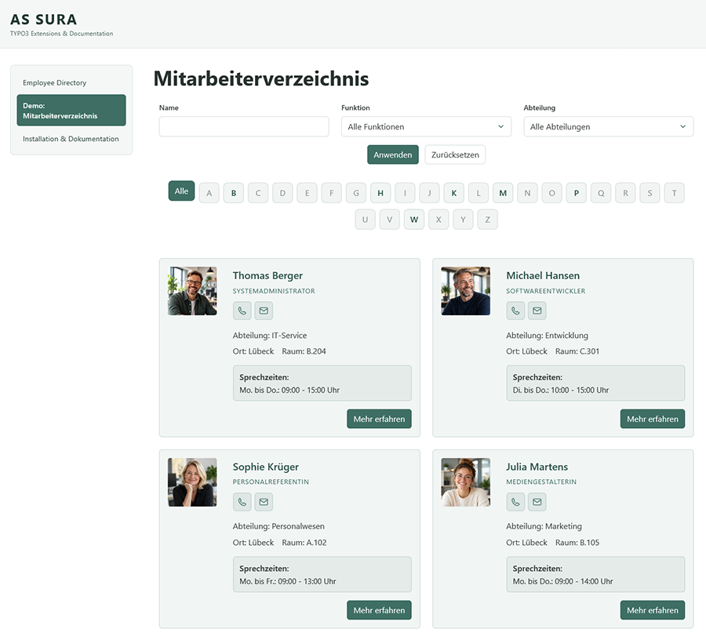
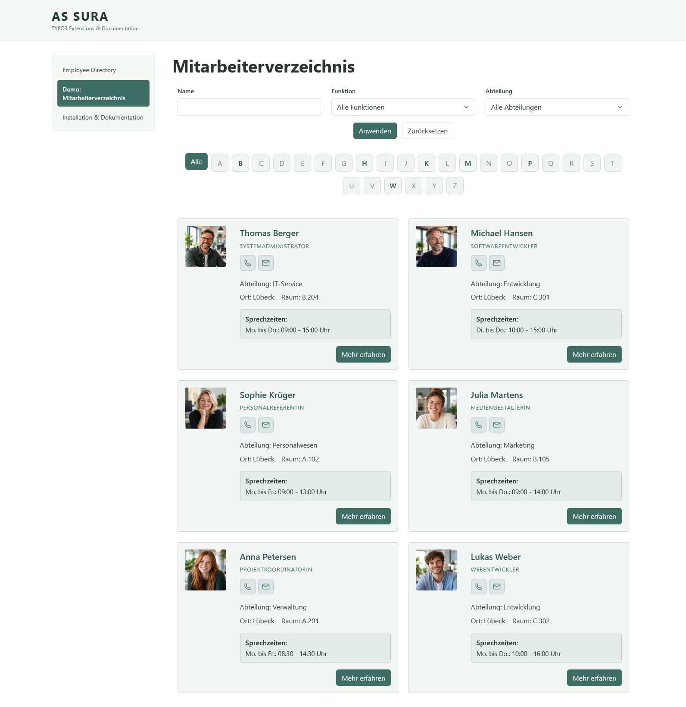
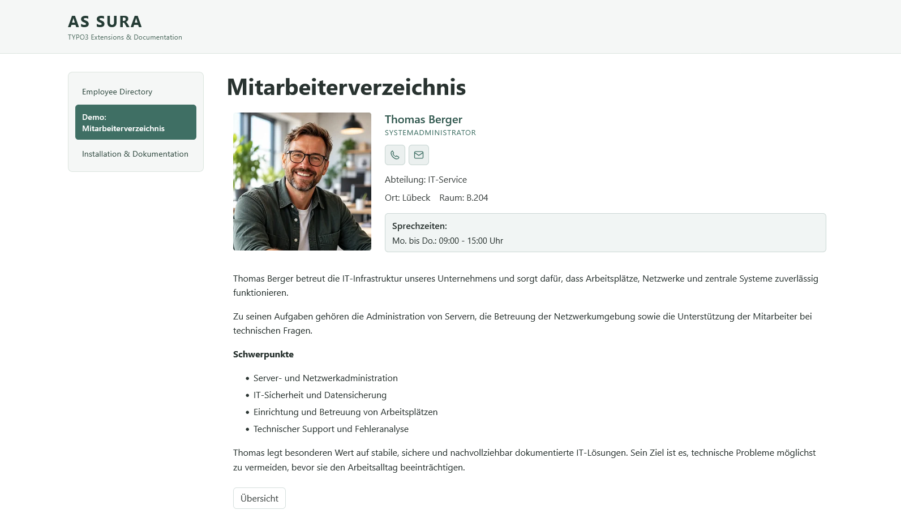

# Mitarbeiterverzeichnis für TYPO3

[English](README.md) | [Deutsch](README.de.md)

Eine TYPO3-Extension zur Verwaltung von Mitarbeiterprofilen und zur Darstellung eines durchsuchbaren und filterbaren Mitarbeiterverzeichnisses.

> **Projektstand (23.10.2026):** Der Quellcode ist öffentlich auf [GitHub](https://github.com/dirklehmann68/employee-directory). Die Installation direkt aus dem GitHub-VCS-Repository und die Funktionstests in einem frisch eingerichteten TYPO3-14.3.10-Projekt mit Composer und DDEV waren erfolgreich. Getestet wurden das kombinierte Verzeichnis, Filter, Bild- und Anzeigeeinstellungen sowie die Navigation zwischen getrennten LIST-/SHOW-Plugins. Die Veröffentlichung auf Packagist bzw. im TER, ein offizieller Release-Tag und weitere Grenzfalltests stehen noch aus.

## Funktionen

- Mitarbeiterdatensätze mit Anrede/Titel, Vorname, Nachname, Bild, Telefon, E-Mail, Raum, Standort, Sprechzeiten und Beschreibung mit Rich-Text-Editor.
- Eigene Datensätze für Abteilungen und Funktionen, die Mitarbeitern zugeordnet werden können.
- Drei Plugin-Varianten: kombiniertes Mitarbeiterverzeichnis (LIST + SHOW), eigenständige Mitarbeiterliste (LIST) und eigenständige Detailansicht (SHOW).
- Mitarbeiterübersicht mit Profilkarten und individuellen Detailansichten.
- Suche nach Nachnamen, Filter nach Abteilung und Funktion sowie alphabetischer A–Z-Filter für Nachnamen.
- In den Auswahllisten erscheinen nur Abteilungen und Funktionen, die Mitarbeiterdatensätzen zugeordnet sind.
- Deutsche und englische Oberflächenbeschriftungen; zusätzlich ist eine plattdeutsche Übersetzung enthalten.
- Integration über ein TYPO3 Site Set mit wählbarem eigenständigem CSS oder Bootstrap-orientiertem CSS.
- Konfigurierbare Filter, Karteninhalte, Bilder, Platzhalter und Frontend-Beschriftungen.

## Vorschau



## Systemvoraussetzungen

- TYPO3 **ab 14.3 und unterhalb von 15.0** (entsprechend den Composer-Versionsbedingungen).
- Eine zur TYPO3-Installation passende PHP- und Datenbankversion.
- TYPO3 Core, Extbase und Fluid (`typo3/cms-core`, `typo3/cms-extbase`, `typo3/cms-fluid`).
- Eine eingerichtete TYPO3-Website mit Site-Konfiguration, Dateispeicher und funktionierender Bildverarbeitung.

## Installation

### Installation mit Composer (vorgesehener Installationsweg)

Der Composer-Paketname lautet `dirk-lehmann/employee-directory`, der TYPO3-Extension-Key `employee_directory`.

**Erfolgreich getestete Installation über GitHub-VCS (TYPO3 14.3.10, DDEV, 23.10.2026):** Im Hauptverzeichnis des TYPO3-Projekts das öffentliche Git-Repository registrieren und die Entwicklungsversion installieren:

```bash
composer config repositories.employee-directory vcs https://github.com/dirklehmann68/employee-directory
composer require "dirk-lehmann/employee-directory:@dev"
```

Unter DDEV beiden Befehlen `ddev` voranstellen. Nach der Installation das TYPO3-Extension-/Datenbank-Setup durchführen, beispielsweise:

```bash
ddev exec vendor/bin/typo3 extension:setup
```

Dieser Installationsweg über GitHub wurde in einem frischen Composer-Projekt überprüft. **Das bedeutet nicht, dass das Paket bereits auf Packagist verfügbar ist.**

**Alternative: lokaler Quellcode-Checkout.** Das Verzeichnis als Composer-Path-Repository in der `composer.json` des **TYPO3-Hauptprojekts** eintragen (Pfad an die eigene Umgebung anpassen):

```json
{
  "repositories": [
    {
      "type": "path",
      "url": "./packages/employee_directory",
      "options": { "symlink": true }
    }
  ]
}
```

Anschließend im Hauptverzeichnis des TYPO3-Projekts ausführen:

```bash
composer require dirk-lehmann/employee-directory:@dev
```

`@dev` kennzeichnet die aktuelle Entwicklungsversion – sowohl bei GitHub-VCS als auch bei lokalen Path-Repositories. Es ist keine Empfehlung für eine produktive Veröffentlichung. Sobald ein getaggtes Release über ein Composer-Repository veröffentlicht wurde, sollte dessen reguläre Versionsnummer verwendet werden. **Eine Veröffentlichung und Verfügbarkeit über Packagist sind noch nicht bestätigt.**

Nach der Installation den Datenbank-/Schema-Abgleich über `extension:setup` oder die TYPO3-Backend-Werkzeuge durchführen. Das Hinzufügen des Composer-Pakets allein garantiert nicht, dass alle Tabellen angelegt sind. Beim frischen DDEV-Test wurde anschließend bestätigt, dass das Datenbankschema aktuell ist.

### Installation ohne Composer (Classic Mode) – ZIP-Upload erfolgreich getestet

**Getestete Umgebung:** TYPO3 14.3.7, klassische Installation ohne Composer auf ALL-INKL, Extension `employee_directory` Version 1.0.0 (14.10.2026).

1. Eine ZIP-Datei erstellen, in der `composer.json`, `Classes/`, `Configuration/` und `Resources/` **direkt auf der obersten Archivebene** liegen – nicht innerhalb eines zusätzlichen Ordners `employee_directory/`.
2. Im TYPO3-Backend unter **System → Einstellungen → Extension Configuration → extensionmanager** die Option **„Install extensions automatically after download from TER or file upload“** (`automaticInstallation`) bei Bedarf deaktivieren und die Einstellung speichern.
3. Im Modul **System → Extension** über **„Erweiterung hochladen“** die Datei `employee_directory.zip` auswählen und hochladen.
4. Die Erfolgsmeldung und den Eintrag **Employee Directory** (`employee_directory`, Version 1.0.0) in der Extension-Liste prüfen.
5. Die Extension über die Spalte **A/D** manuell aktivieren. Anschließend die Einrichtung und gegebenenfalls den Datenbank-/Schema-Abgleich prüfen.

**Beobachtung in dieser Testumgebung:** Mit `automaticInstallation = 1` scheiterte der ZIP-Upload sowohl bei `employee_directory` als auch bei der offiziellen Extension `container` mit der Meldung `Extension … is not available`; anschließend war `typo3conf/ext/` wieder leer. Nach Deaktivierung der automatischen Installation wurden beide ZIP-Dateien erfolgreich hochgeladen und in der Extension-Liste angezeigt. Die manuell aktivierte `employee_directory` lieferte wieder zwei bestehende Mitarbeiter-Cards im Frontend.


Auch die manuelle Installation per FTP wurde erfolgreich getestet. Der ZIP-Upload ist damit praktisch getestet; eine Installation aus dem **TYPO3 Extension Repository (TER)** wurde noch nicht getestet. Eine TER-Veröffentlichung ist nicht bestätigt.

## Einrichtung in TYPO3

1. Extension installieren und aktivieren.
2. Das Site Set der Extension (`dirk-lehmann/employee-directory`) in die Set-Abhängigkeiten der betreffenden Website aufnehmen. Das Set bindet auch das CSS der Extension ein.
3. Eine Seite oder einen Sysfolder als Ablage für Mitarbeiter-, Abteilungs- und Funktionsdatensätze anlegen.
4. Zuerst Abteilungen und Funktionen erstellen, anschließend Mitarbeiterdatensätze anlegen und die Zuordnungen vornehmen.
5. Auf einer Frontend-Seite das kombinierte Plugin **Mitarbeiterverzeichnis** einfügen oder die eigenständigen Plugins **Mitarbeiterliste** und **Mitarbeiterdetail** auf getrennten Seiten verwenden.
6. In den Plugin-Einstellungen die Datensatzablage auswählen. Auch die zugeordneten Abteilungen und Funktionen müssen für die Repository-Abfragen erreichbar sein.
7. Bei getrennten LIST-/SHOW-Plugins in den **Site-Set-Einstellungen** unter der Kategorie für Seitenverknüpfungen **detailPageUid** (Seite mit dem eigenständigen Detail-Plugin) und **listPageUid** (Seite mit dem eigenständigen Listen-Plugin) konfigurieren. Beide Werte stehen standardmäßig auf `0` und müssen für die Navigation zwischen getrennten Seiten auf die jeweiligen Seiten-IDs gesetzt werden. Die Einstellungen befinden sich nicht in der FlexForm des Listen-Plugins.
8. Bei Bedarf Caches leeren und die Frontend-Ausgabe kontrollieren.

Das Site Set importiert `Configuration/TypoScript/setup.typoscript`. Im Hauptverzeichnis der Extension liegt keine Demo-`setup.typoscript` mehr.

### Plugin-Varianten

| Plugin | Aufgabe | Seitenverknüpfung |
| --- | --- | --- |
| **Employee directory** | Kombinierte filterbare Liste und Detailansicht | Die Detailansicht wird innerhalb des kombinierten Plugins verarbeitet. |
| **Employee list** | Eigenständige Mitarbeiterliste | **Page for employee profiles** (`detailPageUid`) auf die Seite mit **Employee detail** setzen. |
| **Employee detail** | Eigenständiges Mitarbeiterprofil | **Page for employee list** (`listPageUid`) auf die Seite mit **Employee list** setzen. |

Für die Navigation zwischen getrennten LIST-/SHOW-Seiten müssen **beide** Seiten-IDs unter **Sites → Settings → Employee Directory → Page linking** eingetragen werden. Im Neuinstallationstest führte die nicht konfigurierte Listen-Seiten-ID `0` dazu, dass der Link **„Übersicht“** die Aktion `EmployeeController->show` ohne das erforderliche Argument `employee` aufrief. Nach Eintragen der korrekten Listen-Seiten-ID funktionierte die Rücknavigation. Die korrekte Konfiguration ist damit erforderlich; der Fall einer fehlenden ID wird bislang nicht elegant abgefangen.

### Anzeige- und Filtereinstellungen

Die folgenden Einstellungen wurden in der frischen TYPO3-Installation überprüft:

- **Sites → Settings → Employee Directory → Filter:** Namenssuche, Funktionsfilter, Abteilungsfilter und A–Z-Filter einzeln ein-/ausblenden. Sind alle drei Formularfilter ausgeschaltet, verschwinden auch die Schaltflächen zum Anwenden und Zurücksetzen; der A–Z-Filter ist unabhängig davon.
- **Sites → Settings → Employee Directory → Appearance:** Zwischen **Standalone CSS** und **Bootstrap CSS** wechseln. Im Test wurde jeweils nur das ausgewählte Stylesheet geladen.
- **Sites → Settings → Employee Directory:** Frontend-Beschriftungen optional überschreiben. Leere Überschreibungen verwenden wieder die übersetzten Standardbeschriftungen.
- **Inhaltselement → Plugin → Card content:** Funktion, Abteilung, Telefon, E-Mail, Standort, Raum und Sprechzeiten einzeln ein-/ausblenden.
- **Inhaltselement → Plugin → Images:** Mitarbeiterfotos und Platzhalter bei fehlendem Foto ein-/ausblenden. Bei deaktivierter Fotoanzeige wird auch kein Platzhalter angezeigt.

Die getesteten Schalter für Karteninhalte und Bilder betreffen **nur die LIST-Darstellung**, nicht die Felder in der **SHOW-Detailansicht**. Der Ausgangspunkt für die Datensatzablage muss wie oben beschrieben im Listen-Plugin eingerichtet sein.

## Sprechende URLs (Route Enhancer)

TYPO3 erzeugt ohne passende Routing-Konfiguration für Detailansichten gegebenenfalls URLs mit Extbase-Query-Parametern. Für lesbare Mitarbeiter-URLs kann in der **Site-Konfiguration der jeweiligen Website** (`config/sites/<site-identifier>/config.yaml`, je nach Projektstruktur) ein Route Enhancer eingerichtet werden. **Die Extension installiert diese Konfiguration nicht automatisch.**

Das folgende vollständige Beispiel enthält zwei Varianten: einen Route Enhancer für das kombinierte Plugin auf Seite **3** und einen zweiten für das eigenständige Detail-Plugin auf Seite **5**. **Diese Seiten-IDs sind Beispiele und müssen an die eigene Installation angepasst werden.** Wer nur das kombinierte Plugin verwendet, benötigt nur den ersten Enhancer.

```yaml
routeEnhancers:
  EmployeeDirectory:
    type: Extbase
    extension: EmployeeDirectory
    plugin: EmployeeList
    limitToPages:
      - 3  # REPLACE: page UID containing the combined plugin
    routes:
      -
        routePath: '/{employee}'
        _controller: 'Employee::show'
        _arguments:
          employee: employee
    defaultController: 'Employee::list'
    aspects:
      employee:
        type: PersistedAliasMapper
        tableName: tx_employeedirectory_domain_model_employee
        routeFieldName: slug

  EmployeeDirectoryDetail:
    type: Extbase
    extension: EmployeeDirectory
    plugin: EmployeeDetail
    limitToPages:
      - 5  # REPLACE: page UID containing the standalone detail plugin
    routes:
      -
        routePath: '/{employee}'
        _controller: 'Employee::show'
        _arguments:
          employee: employee
    aspects:
      employee:
        type: PersistedAliasMapper
        tableName: tx_employeedirectory_domain_model_employee
        routeFieldName: slug
```

**Wichtige Hinweise:**

- `limitToPages` begrenzt jeden Enhancer auf die tatsächlich zugehörige Plugin-Seite. Ohne diese Begrenzung können sich die beiden Enhancer gegenseitig beeinflussen; im Praxistest führte das bei der getrennten Detailseite zu einer fehlenden `employee`-Action-Argument-Zuordnung.
- `routeFieldName: slug` verweist auf das Slug-Feld des Mitarbeiterdatensatzes. Das Feld muss für den jeweiligen Datensatz korrekt befüllt sein.
- Für getrennte LIST-/SHOW-Plugins müssen zusätzlich `detailPageUid` und `listPageUid` in den **Site-Set-Einstellungen** auf die jeweiligen Seiten zeigen.
- **Mehrere TYPO3-Sites:** In unserem Test konnten Mitarbeiter aus einer Datensatzablage unterhalb einer anderen Site über den konfigurierten Extbase-Ausgangspunkt gelistet werden, während die Slug-Auflösung des `PersistedAliasMapper` zu 404 führte. Ein Mitarbeiter in einer Datensatzablage innerhalb des Demo-Site-Baums ließ sich dagegen per Slug aufrufen. Dies ist eine Beobachtung aus unserer Installation, kein allgemeiner Nachweis über sämtliche TYPO3-Konfigurationen. Prüfe bei 404 daher auch die Site-Zugehörigkeit und den Speicherort der Datensätze.
- Jede TYPO3-Site benötigt ihre eigene passende Site-Konfiguration und die richtigen `limitToPages`-Werte. Nach Änderungen gegebenenfalls TYPO3-Caches leeren.

## Bedienung

Besucher können Mitarbeiter nach Nachnamen suchen sowie nach Funktion, Abteilung und Anfangsbuchstaben des Nachnamens filtern. Über eine Profilkarte gelangt man zur Detailansicht. Der aktuelle Link **„Zurück zur Übersicht“** führt zur ungefilterten Liste. Die Rückkehr unter Beibehaltung der Filter ist für eine spätere Version vorgesehen.

Mit dem Schalter **„Datensatz verbergen“** lässt sich die Anzeige eines Mitarbeiters im Frontend unterbinden. Die getrennten LIST- und SHOW-Plugins wurden mit neu angelegten Datensätzen in der frischen TYPO3-14.3.10-Composer-Installation erfolgreich getestet. Noch offene Grenzfälle sind weiter unten aufgeführt.

Der **„Mehr“**-Button erscheint in der Liste nur bei Mitarbeitern mit einer Beschreibung. Im eigenständigen Listen-Plugin führt er zur konfigurierten Detailseite; der **„Zurück zur Übersicht“**-Button der eigenständigen Detailansicht führt zur konfigurierten Listenseite.

## Sprachen

Die Oberflächenbeschriftungen liegen auf Deutsch und Englisch vor; zusätzlich gibt es eine plattdeutsche Frontend-Übersetzung. **Die Fachdatensätze selbst sind bislang nicht für den TYPO3-Übersetzungsworkflow eingerichtet.** Eine übersetzte Bedienoberfläche bedeutet also nicht automatisch übersetzte Mitarbeiter-, Abteilungs- oder Funktionsdatensätze.

## Bekannte Einschränkungen

- Der A–Z-Filter bezieht sich auf Nachnamen. Die Suche nach Umlauten kann von der Datenbank-Kollation abhängen.
- Eine Seitennavigation (Pagination) für umfangreiche Verzeichnisse ist noch nicht vorhanden.
- Mehrere unabhängig filterbare Plugin-Instanzen auf derselben Seite sind noch nicht getestet.
- Ein Route Enhancer für sprechende URLs wird nicht automatisch mitgeliefert; ein vollständiges Konfigurationsbeispiel steht oben.
- Die Rücknavigation zur Liste erhält gesetzte Filter noch nicht.
- Die Navigation zwischen getrennten LIST-/SHOW-Plugins wurde in der frischen Installation in beide Richtungen erfolgreich getestet. Direktlinks auf verborgene/gelöschte Datensätze, fehlende Zielseiten-IDs, mehrere Instanzen und Cache-Grenzfälle sind noch gesondert zu prüfen.
- Eine fehlende Listen-Seiten-ID kann beim Rücklink der eigenständigen Detailansicht eine Frontend-Exception auslösen. Deshalb beide Seiten-IDs konfigurieren.
- Der ZIP-Upload und die manuelle Aktivierung im Classic Mode wurden in einer separaten TYPO3-14.3.7-Installation erfolgreich getestet; eine vollständige Erstinstallation mit neu angelegten Datensätzen und alle Funktionstests stehen noch aus.

## Fehlerbehebung

| Problem | Prüfen |
| --- | --- |
| ZIP-Upload meldet `Extension employee_directory is not available` | In der getesteten TYPO3-14.3.7-Classic-Installation half es, unter Extension Configuration → extensionmanager `automaticInstallation` zu deaktivieren, die ZIP-Datei erneut hochzuladen und die Extension anschließend manuell zu aktivieren. Kein allgemeiner Nachweis für andere Installationen. |
| Slug-URL führt zu 404 | `limitToPages`, Slug-Feld, Site-Konfiguration und Site-Zugehörigkeit der Datensätze kontrollieren. |
| Keine Mitarbeiter sichtbar | Datensatzablage im Plugin, Sichtbarkeit der Datensätze und Speicherort. |
| Abteilung oder Funktion fehlt im Filter | Existenz, Erreichbarkeit und Zuordnung zu sichtbaren Mitarbeitern. |
| Darstellung ohne CSS | Ist das Site Set in der Website-Konfiguration eingebunden? |
| Bilder fehlen | Dateireferenzen, Zugriffsrechte und TYPO3-Bildverarbeitung. |
| Richtext wird unerwartet dargestellt | Rich-Text-Editor und wirksame TypoScript-Konfiguration. |
| Filter gehen beim Wechsel zurück zur Übersicht verloren | Bekannte Einschränkung; Verbesserung für eine spätere Version geplant. |
| Rücklink der eigenständigen Detailansicht erzeugt `RequiredArgumentMissingException` | **Sites → Settings → Employee Directory → Page linking → Page for employee list** prüfen und die tatsächliche Seiten-ID der eigenständigen Liste eintragen. Der Standardwert `0` ist für diese Konstellation ungeeignet. |

## Checkliste vor der Veröffentlichung

- [x] Installation aus dem öffentlichen GitHub-VCS-Repository in einem **unabhängigen TYPO3-14.3.10-Projekt mit Composer/DDEV** (23.10.2026).
- [x] Composer-Abhängigkeiten und TYPO3-Datenbankschema in diesem Projekt geprüft.
- [x] Site Set und Auswahl zwischen eigenständigem und Bootstrap-Stylesheet ohne Demo-TypoScript getestet.
- [x] Abteilung, Funktion und Mitarbeiter in einer neuen Datensatzablage angelegt.
- [x] Liste, Detailansicht, Bilder, Platzhalter, Richtext, Suche, Filter, Zurücksetzen und Anzeige bei fehlenden Suchergebnissen im frischen Projekt getestet.
- [x] Einzelne Schalter für Karteninhalte und Bilder sowie Site-Set-Filter und Beschriftungen getestet.
- [x] Navigation LIST → SHOW → LIST einschließlich erneuten Durchlaufens mit beiden konfigurierten Seiten-IDs geprüft.
- [x] Deutsche Frontend-Beschriftungen in der frischen Installation überprüft.
- [x] ZIP-Upload und manuelle Aktivierung im Classic Mode unter TYPO3 14.3.7 erfolgreich getestet (14.10.2026).
- [ ] Sämtliche Funktionen bei **ausdrücklich aktiviertem Seiten-Cache** und weitere Cache-Grenzfälle prüfen.
- [ ] Direktlinks auf verborgene/gelöschte Mitarbeiter, fehlende Seiten-ID-Konfiguration und mehrere Plugin-Instanzen testen.
- [ ] Englische Bedienoberfläche ausdrücklich testen sowie zusätzliche Fälle der Datensatzsichtbarkeit prüfen.
- [ ] Vollständige Erstinstallation im Classic Mode einschließlich Schema-Abgleich, neuer Datensätze und aller Funktionen testen.
- [ ] Geprüfte Screenshots und Veröffentlichungsangaben vor der Veröffentlichung ergänzen.

## Screenshots

### Mitarbeiterverzeichnis (LIST)



### Mitarbeiterprofil (SHOW)



## Lizenz

GPL-2.0-or-later (laut `composer.json`).
