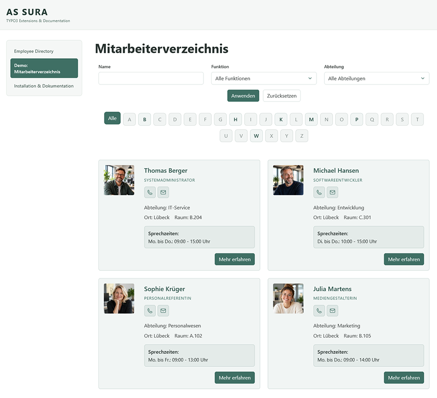
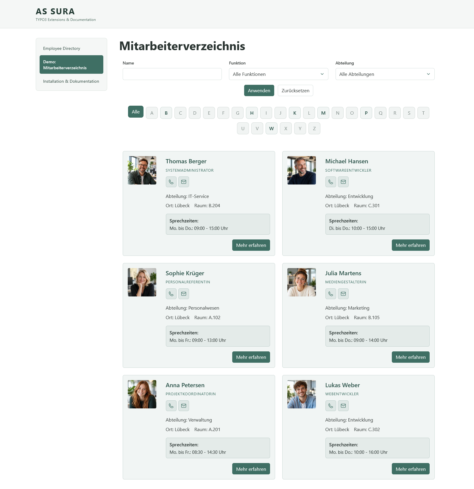
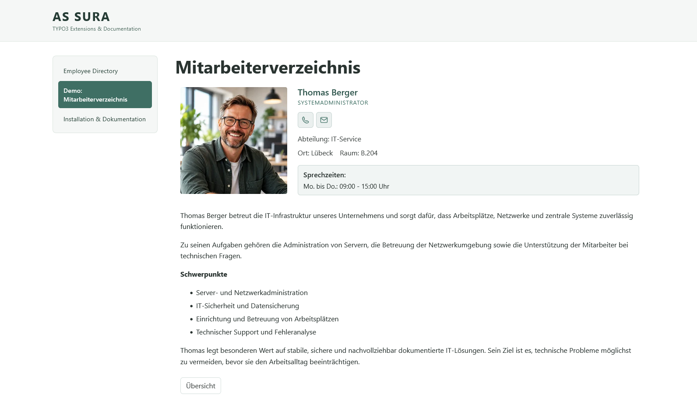

# Employee Directory for TYPO3

[English](README.md) | [Deutsch](README.de.md)

A TYPO3 extension for managing employee profiles and displaying a searchable, filterable employee directory.

> **Project status (11 November 2026):** Version **1.2.0** is being prepared for release; it has **not yet been published**. It adds configurable department ordering to the department-grouped LIST view. Selected departments appear first in the specified order, remaining departments follow alphabetically, and employees without a department remain at the end. The new backend configuration and its German/English labels were tested in TYPO3 14.3.6 (Composer, Mittwald). A final regression test and release packaging are still pending. Earlier version **1.1.0** was published to the TYPO3 Extension Repository (TER), and the existing **v1.1.1** Git tag is available on GitHub. The tests described below cover particular environments and cases, not every configuration or edge case.

## Features

* Employee records with salutation/title, first and last name, photo, phone number, email, room, location, office hours, and a rich-text description.
* Separate department and job-function records that can be assigned to employees.
* Three plugin variants: combined employee directory (LIST + SHOW), standalone employee list (LIST), and standalone employee detail view (SHOW).
* Employee overview with profile cards and individual detail pages.
* **New in version 1.1.0:** Choose between the standard list and a list grouped by department. Groups are sorted alphabetically by department name; employees within each group are sorted by last name and then first name. Employees without an assigned department appear in a separate group at the end.
* **New in version 1.2.0 (release in preparation):** In department-grouped LIST mode, optionally prioritize selected departments using a sortable selection in the plugin settings. Departments not selected remain visible in alphabetical order; employees without a department stay at the end. The standard list and SHOW view are unaffected.
* Search by last name, filter by department or job function, and an alphabetical A–Z filter for last names.
* Filter dropdowns include only departments and job functions assigned to employee records.
* German and English interface labels, plus an additional Low German translation.
* Integration through a TYPO3 Site Set, with a choice of standalone CSS or Bootstrap-oriented CSS.
* Configurable filters, card content, images, placeholders, and frontend labels.

## Preview

[](Documentation/Images/employee-preview.png)

## Requirements

* TYPO3 **14.3 or later, but below 15.0** (as specified by the Composer version constraints).
* PHP and database versions compatible with the TYPO3 installation.
* TYPO3 Core, Extbase, and Fluid (`typo3/cms-core`, `typo3/cms-extbase`, `typo3/cms-fluid`).
* A configured TYPO3 site with file storage and working image processing.

## Installation

### Composer installation (preferred method)

The Composer package name is `dirk-lehmann/employee-directory`; the TYPO3 extension key is `employee_directory`.

**Successfully tested installation via GitHub VCS (TYPO3 14.3.10, DDEV, 23 October 2026):** Register the public Git repository and install the development version from the TYPO3 project root:

```bash
composer config repositories.employee-directory vcs https://github.com/dirklehmann68/employee-directory
composer require "dirk-lehmann/employee-directory:@dev"
```

When using DDEV, prefix both commands with `ddev`. After installation, run the TYPO3 extension/database setup, for example:

```bash
ddev exec vendor/bin/typo3 extension:setup
```

This GitHub installation method was verified in a fresh Composer project. **It describes the development workflow tested at that time; regular Composer installation is preferable for published versions.**

**Alternative: local source checkout.** Register the checkout as a Composer path repository in the **main TYPO3 project's** `composer.json` (adjust the path for your environment):

```json
{
  "repositories": [
    {
      "type": "path",
      "url": "./packages/employee_directory",
      "options": { "symlink": true }
    }
  ]
}
```

Then run from the TYPO3 project root:

```bash
composer require dirk-lehmann/employee-directory:@dev
```

`@dev` refers to the current development version, both for GitHub VCS and local path repositories. It is not a recommendation for production deployments. Once a tagged release is available through a Composer repository, use its regular version constraint instead. **The `@dev` commands above are intended for development installations.**

After installation, synchronize the database schema using `extension:setup` or the TYPO3 backend tools. Adding the Composer package alone does not guarantee that all database tables have been created. The fresh DDEV test subsequently confirmed that the schema was up to date.

### Installation without Composer (Classic Mode) – ZIP upload successfully tested

**Original ZIP installation test:** TYPO3 14.3.7, Classic Mode on ALL-INKL, `employee_directory` version 1.0.0 (14 October 2026). **Additional update test:** On 7 November 2026, an existing version 1.0.1 installation on as-sura.de was successfully updated to **1.1.0** directly from TER through the TYPO3 Extension Manager.

1. Create a ZIP file with `composer.json`, `Classes/`, `Configuration/`, and `Resources/` **at the archive root**, not inside an additional `employee_directory/` folder.
2. In the TYPO3 backend, under **System → Settings → Extension Configuration → extensionmanager**, disable **“Install extensions automatically after download from TER or file upload”** (`automaticInstallation`) if needed, and save the setting.
3. In **System → Extensions**, choose **Upload Extension**, select `employee_directory.zip`, and upload it.
4. Check the success message and the **Employee Directory** entry (`employee_directory`, version 1.0.0) in the extension list.
5. Activate the extension manually using the **A/D** column. Then verify the setup and database schema as needed.

**Observation in this test environment:** With `automaticInstallation = 1`, ZIP uploads of both `employee_directory` and the official `container` extension failed with `Extension … is not available`; afterward, `typo3conf/ext/` was empty again. After automatic installation was disabled, both ZIP files uploaded successfully and appeared in the extension list. The manually activated `employee_directory` again displayed two existing employee cards in the frontend.

Manual installation via FTP was also tested successfully. The original ZIP upload test used version 1.0.0. **New:** Updating an existing Classic Mode installation from 1.0.1 to **1.1.0 directly through the TYPO3 Extension Manager / TER** succeeded without errors. A SQL export and a local webspace backup were created before updating. This confirms a successful update, not a complete fresh installation of version 1.1.0 from TER.

## TYPO3 setup

1. Install and activate the extension.
2. Add the extension's Site Set (`dirk-lehmann/employee-directory`) to the dependencies of the relevant site. The set also includes the extension's CSS.
3. Create a page or sysfolder to store employee, department, and job-function records.
4. Create departments and job functions first, then create employee records and assign their relations.
5. Add the combined **Employee directory** plugin to a frontend page, or place the standalone **Employee list** and **Employee detail** plugins on separate pages.
6. Select the record storage location in the plugin settings. Related departments and job functions must also be accessible to the repository queries.
7. For separate LIST/SHOW plugins, configure **detailPageUid** (page containing the standalone detail plugin) and **listPageUid** (page containing the standalone list plugin) in the **Site Set settings**, under page linking. Both default to `0` and must be set to the respective page IDs for navigation between separate pages. These settings are not part of the list plugin's FlexForm.
8. Flush caches if necessary and verify the frontend output.

The Site Set imports `Configuration/TypoScript/setup.typoscript`. There is no longer a demo `setup.typoscript` in the extension root.

### Plugin variants

| Plugin | Purpose | Page linking |
| --- | --- | --- |
| **Employee directory** | Combined filterable list and detail view | The detail view is handled within the combined plugin. |
| **Employee list** | Standalone employee list | Set **Page for employee profiles** (`detailPageUid`) to the page containing **Employee detail**. |
| **Employee detail** | Standalone employee profile | Set **Page for employee list** (`listPageUid`) to the page containing **Employee list**. |

For navigation between separate LIST/SHOW pages, **both** page IDs must be set under **Sites → Settings → Employee Directory → Page linking**. In the fresh-installation test, leaving the list page ID at `0` caused the **Back to overview** link to call `EmployeeController->show` without the required `employee` argument. Setting the correct list page ID restored navigation. Correct configuration is therefore necessary; the extension does not yet handle a missing ID gracefully.

### Display and filter settings

The settings below were checked in the test environments described in this document. Department grouping was tested on Mittwald (TYPO3 14.3.6) and as-sura.de (TYPO3 14.3.7); the new 1.2.0 ordering control was tested on Mittwald:

* **Sites → Settings → Employee Directory → Filter:** Toggle name search, job-function filter, department filter, and A–Z filter independently. If all three form filters are disabled, the Apply and Reset buttons disappear as well; the A–Z filter is independent.
* **Sites → Settings → Employee Directory → Appearance:** Switch between **Standalone CSS** and **Bootstrap CSS**. Only the selected stylesheet was loaded in the test.
* **Sites → Settings → Employee Directory:** Optionally override frontend labels. Empty overrides fall back to the translated defaults.
* **Content element → Plugin → Display (since version 1.1.0):** Under **Employee list display**, choose **Standard view** or **Grouped by department**. The standard view remains unchanged. In grouped mode, department headings appear above the relevant cards. The A–Z filter still applies to **last names**, not department names. The dedicated **Display** tab was verified in the TYPO3 14.3.6 and 14.3.7 backends.
* **Content element → Plugin → Display (new in 1.2.0):** When **Grouped by department** is selected, **Department order** lets editors choose and arrange departments from the configured record storage. Selected departments are displayed first in the chosen order; unselected departments follow alphabetically. Groups without visible employees are not shown, and employees without an assigned department remain in the final group. Leaving the custom order empty preserves alphabetical department sorting. This affects LIST only, not SHOW.
* **Content element → Plugin → Card content:** Toggle job function, department, phone, email, location, room, and office hours independently.
* **Content element → Plugin → Images:** Toggle employee photos and placeholders for missing photos. Disabling photo display also disables the placeholder.

The tested card-content and image toggles affect the **LIST view only**, not the fields in the **SHOW detail view**. The record storage starting point must be configured in the list plugin as described above.

## Human-readable URLs (Route Enhancer)

Without suitable routing configuration, TYPO3 may generate detail-view URLs containing Extbase query parameters. For readable employee URLs, configure a Route Enhancer in the **site configuration of the relevant website** (`config/sites/<site-identifier>/config.yaml`, depending on the project structure). **The extension does not install this configuration automatically.**

The following complete example contains two enhancers: one for the combined plugin on page **3**, and another for the standalone detail plugin on page **5**. **These page IDs are examples and must be adjusted to your installation.** If you use only the combined plugin, you need only the first enhancer.

```yaml
routeEnhancers:
  EmployeeDirectory:
    type: Extbase
    extension: EmployeeDirectory
    plugin: EmployeeList
    limitToPages:
      - 3  # REPLACE: page UID containing the combined plugin
    routes:
      -
        routePath: '/{employee}'
        _controller: 'Employee::show'
        _arguments:
          employee: employee
    defaultController: 'Employee::list'
    aspects:
      employee:
        type: PersistedAliasMapper
        tableName: tx_employeedirectory_domain_model_employee
        routeFieldName: slug

  EmployeeDirectoryDetail:
    type: Extbase
    extension: EmployeeDirectory
    plugin: EmployeeDetail
    limitToPages:
      - 5  # REPLACE: page UID containing the standalone detail plugin
    routes:
      -
        routePath: '/{employee}'
        _controller: 'Employee::show'
        _arguments:
          employee: employee
    aspects:
      employee:
        type: PersistedAliasMapper
        tableName: tx_employeedirectory_domain_model_employee
        routeFieldName: slug
```

**Important notes:**

* `limitToPages` restricts each enhancer to its corresponding plugin page. Without this restriction, the enhancers may interfere with each other; in our test, the separate detail page then failed to map the required `employee` action argument.
* `routeFieldName: slug` refers to the employee record's slug field, which must be populated correctly.
* For separate LIST/SHOW plugins, `detailPageUid` and `listPageUid` must also point to the corresponding pages in the **Site Set settings**.
* **Multiple TYPO3 sites:** In our test, employees stored under a different site could be listed via the configured Extbase starting point, while slug resolution through `PersistedAliasMapper` returned a 404. An employee stored within the demo site's page tree could be opened by slug. This is an observation from our installation, not a general conclusion for all TYPO3 configurations. If you encounter a 404, also check site ownership and record storage location.
* Each TYPO3 site requires its own suitable site configuration and correct `limitToPages` values. Flush TYPO3 caches after changes if needed.

## Usage

Visitors can search by employee last name and filter by job function, department, or the first letter of the last name. Profile cards link to detail views. The current **Back to overview** link returns to the unfiltered list. Preserving filters when navigating back is planned for a future version.

The **Hide record** toggle prevents an employee from appearing in the frontend. Separate LIST and SHOW plugins were successfully tested with newly created records in a fresh TYPO3 14.3.10 Composer installation. Outstanding edge cases are listed below.

The **More** button appears in the list only for employees with a description. In the standalone list plugin, it opens the configured detail page; the **Back to overview** button in the standalone detail view leads to the configured list page.

## Languages

Interface labels are available in German and English; an additional Low German frontend translation is included. **The domain records themselves are not yet configured for TYPO3's translation workflow.** A translated interface does not automatically mean translated employee, department, or job-function records.

## Known limitations

* The A–Z filter applies to last names. Searching for umlauts may depend on the database collation.
* Pagination for large directories is not yet available.
* Multiple independently filterable plugin instances on the same page have not yet been tested.
* A Route Enhancer for human-readable URLs is not provided automatically; a complete configuration example appears above.
* Returning to the list does not preserve active filters.
* Navigation between separate LIST/SHOW plugins was successfully tested in both directions in the fresh installation. Direct links to hidden/deleted records, missing target page IDs, multiple instances, and caching edge cases require further testing.
* A missing list page ID may cause a frontend exception when using the standalone detail view's back link. Configure both page IDs.
* ZIP upload and manual activation in Classic Mode were successfully tested on TYPO3 14.3.7 (version 1.0.0). A subsequent **TER update from 1.0.1 to 1.1.0** succeeded on the same TYPO3 version; a complete fresh 1.1.0 installation with all functional tests remains outstanding.

## Troubleshooting

| Problem | What to check |
| --- | --- |
| ZIP upload reports `Extension employee_directory is not available` | In the tested TYPO3 14.3.7 Classic installation, disabling `automaticInstallation` under Extension Configuration → extensionmanager, uploading again, and manually activating the extension resolved the issue. This has not been established as a general solution for other installations. |
| Slug URL returns 404 | Check `limitToPages`, slug field, site configuration, and the site associated with the records. |
| No employees are shown | Check the plugin's record storage starting point, record visibility, and storage location. |
| Department or job function is missing from a filter | Check that it exists, is accessible, and is assigned to visible employees. |
| No CSS styling | Check whether the Site Set is included in the website configuration. |
| Images are missing | Check file references, permissions, and TYPO3 image processing. |
| Rich text renders unexpectedly | Check the rich-text editor and effective TypoScript configuration. |
| Filters are lost after returning to the overview | Known limitation; an improvement is planned for a future version. |
| Standalone detail back link triggers `RequiredArgumentMissingException` | Check **Sites → Settings → Employee Directory → Page linking → Page for employee list** and enter the actual page ID of the standalone list. The default `0` is unsuitable in this setup. |

### Test status of the published 1.1.0 release

* **TYPO3 14.3.6, Composer, Mittwald (6–7 November 2026):** The local development build was transferred via SSH/SCP into a separate staging directory and then deployed to the test installation. The previous active extension was backed up; a directory comparison confirmed that the deployed files matched the staging version.
* The modified `EmployeeController.php` passed PHP syntax checking. `EmployeeList.xml`, `locallang.xlf`, and `de.locallang.xlf` passed XML syntax checks. These checks do not replace functional testing.
* The new **Display** FlexForm tab was verified in the backend with its German label and the choices **Standard view** and **Grouped by department**. The **Card content** and **Images** tabs remained available.
* The department-grouped employee list was visually checked in Bootstrap mode with several departments, rows containing one or two cards, and a narrow layout. Hiding the department field within individual cards was tested using the existing plugin setting.
* **Combined filtering verified:** Searching for `Dauer` while selecting the job function `Unfallchirurg` returned only **Dr. med. Manfred Dauerbruch** under the **Unfallchirurgie** department heading. The A–Z filter also visibly adjusted. This confirms the tested combination, not every possible filter combination.
* During an earlier test, deploying new extension files required a database schema update (`hidden` fields for departments and job functions). Afterward, backend records and frontend output were accessible again.
* **TYPO3 14.3.7, Classic Mode, ALL-INKL / as-sura.de (7 November 2026):** The published **1.1.0** release was installed as an update from version 1.0.1 through the TER-backed Extension Manager. The update completed without errors; all three FlexForm tabs and the display selection were checked in the backend.
* **Frontend checks on as-sura.de:** The grouped list displayed employee cards under the expected department headings. Selected search/filter cases, the empty-results message, and a newly created employee **without a department** were checked. The **Without department** group appeared after the regular departments; the card and placeholder image also rendered.
* **Still pending:** systematic regression testing of all filter and display combinations, language variants, caching and routing edge cases, and a complete fresh installation of the published 1.1.0 release. Successful individual checks are not exhaustive acceptance testing.

## Version 1.2.0 development checks (11 November 2026)

* **TYPO3 14.3.6, Composer, Mittwald:** The optional department-order selector was populated from departments in the configured record storage and saved successfully. The selected department order was checked in the grouped frontend list. Unselected departments continued alphabetically; employees without a department remained last.
* The list configuration was tested with German and English backend labels, including the new descriptions for the three FlexForm tabs and department ordering.
* **Still pending before the 1.2.0 release:** A focused regression test of the standard and grouped LIST modes, filters, both list plugin variants, and SHOW navigation, plus release packaging. These development checks are not a complete acceptance test.

## Test history and further checks

Some items below document earlier 1.0.x tests, while others cover the published 1.1.0 release. **Earlier tests must not automatically be treated as a renewed acceptance test of 1.1.0.**

* Installation from the public GitHub VCS repository in an **independent TYPO3 14.3.10 Composer/DDEV project** (23 October 2026).
* Composer dependencies and TYPO3 database schema verified in that project.
* Site Set and selection between standalone and Bootstrap stylesheets tested without demo TypoScript.
* Department, job function, and employee created in a new record storage location.
* List, detail view, images, placeholders, rich text, search, filters, reset, and empty-result display tested in the fresh project.
* Individual card-content and image toggles, Site Set filters, and labels tested.
* LIST → SHOW → LIST navigation verified, including another run with both page IDs configured.
* German frontend labels verified in the fresh installation.
* ZIP upload and manual activation in Classic Mode on TYPO3 14.3.7 successfully tested (14 October 2026).
* Test all features with **page caching explicitly enabled**, plus additional caching edge cases.
* Test direct links to hidden/deleted employees, missing page ID configuration, and multiple plugin instances.
* Explicitly test the English interface and additional record-visibility cases.
* Test a complete fresh Classic Mode installation, including schema synchronization, new records, and all features.
* Update screenshots as needed to reflect the published feature set.
* **1.1.0 – verified:** Department grouping, new tabs with German labels, Bootstrap layout, and selected filter combinations (Mittwald); plus TER update, backend display selection, grouped frontend list, empty results, and an employee without a department (as-sura.de).
* **1.1.0 – still pending:** exhaustive checks of both views and all filter combinations, language variants, multiple plugin instances, caching edge cases, and a complete fresh installation of the published release package.

## Outlook and roadmap

Employee Directory will be developed incrementally, with an emphasis on ease of use, clear configuration, and a deliberately manageable feature set. **The following items are ideas or development intentions, not promised features or release dates.** They are **not part of the planned version 1.2.0**.

* **Faceted filtering:** Adapt available filter options to previously selected criteria without making active selections inaccessible.
* **Alternative card layouts:** Consider a more compact layout with fewer profile details alongside the existing cards.
* **Independently configurable grouping:** Allow grouping (for example, none, by department, or alphabetically by last name) and card layout to be configured separately in the future.
* **Scheduled visibility:** Support TYPO3's standard publication start and end fields (`starttime`/`endtime`) for employee records, including verification of TCA, repository behavior, and caching. This support has not yet been documented as fully implemented and tested in the extension.
* **Improved back navigation:** Preserve search and filter selections when returning from a detail view to the list.
* **Pagination:** Add page navigation for larger employee directories.
* **Optional address and map display:** Consider an address field with a map on employee detail pages; technical and data-protection questions remain to be resolved.
* **CSV import:** Import employee data, for example from Excel, through a **separate, optional extension** so that the main extension remains focused.

The order, scope, and implementation of these ideas may change. No specific future version numbers have been assigned to them.

## Screenshots

### Employee directory (LIST)

[](Documentation/Images/employee-list.png)

### Employee profile (SHOW)

[](Documentation/Images/employee-detail.png)

## License

This extension is licensed under the GNU General Public License, version 2 or later (GPL-2.0-or-later).

The license is specified in [`composer.json`](composer.json). See [LICENSE](LICENSE) for the full license text.
